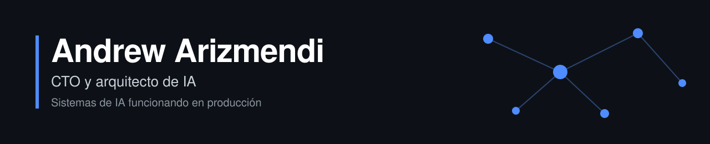

  

  
  
  

<i>Convierto procesos manuales que toman meses en sistemas de IA que operan en semanas, y los entrego funcionando en producción.</i>

---

## Casos

| Caso | Problema | Enfoque | Resultado |
|---|---|---|---|
| **IA documental en banca regulada** | Análisis de crédito corporativo con revisión manual de expedientes y requisitos AML/PLD | Rediseñé el flujo antes de automatizarlo y construí un pipeline con machine learning para localizar documentos y reconocer su contenido | De meses a semanas, a escala de decenas de miles de empresas al mes y con cumplimiento total |
| **Gestión hotelera con IA** | La operación de hoteles y propiedades vacacionales vive repartida entre herramientas que no se hablan | Un orquestador de IA sobre un sistema de gestión de propiedades, con módulos como housekeeping y spa | Del MVP en pocas semanas a un producto con clientes, presentado en ferias del sector |
| **Suite empresarial** | Las empresas contratan por separado proyectos, asistencia, contratos y talento | Tres sistemas propios que se integran hacia un ERP | En venta a clientes corporativos de varios sectores |
| **Adopción de IA en equipos** | Las herramientas de IA se compran, pero los equipos no las adoptan | Capacitación aplicada a cada área y herramientas a medida | Decenas de personas capacitadas en banca, hotelería, aerolíneas e industria |

## Habilidades

**Arquitectura de IA**&nbsp;         

**Python y ML**&nbsp;     

**Full stack**&nbsp;     

**DevOps y nube**&nbsp;      

## Trayectoria

| Periodo | Rol | Organización |
|---|---|---|
| 2026 a hoy | CTO y cofundador de Melius Go | Melius Services |
| 2025 a 2026 | Director de IA y, antes, Desarrollador de IA | Melius Services |
| 2024 a 2025 | Gerente de TI y Desarrollo Web | Marmi ST Angelo |
| 2022 a 2024 | Líder de Desarrollo Web y Transformación Digital | Conecta MX |
| 2020 a 2022 | Soporte técnico y desarrollo web | T100 |

## Formación

Máster en Inteligencia Artificial, Ingeniería en Ciencia de Datos e Ingeniería en Sistemas Computacionales (UANE by ULA). 29 cursos de Anthropic: Claude API, Claude Code, MCP, subagentes y agent skills.

## Código abierto

[**ai-core**](https://github.com/salvex93/ai-core): núcleo multi-agente que enruta entre modelos de distintos proveedores.

---

> No pongo IA encima de procesos rotos. Rediseño el flujo alrededor de lo que la IA hace bien y luego lo construyo, con números que lo respaldan.
